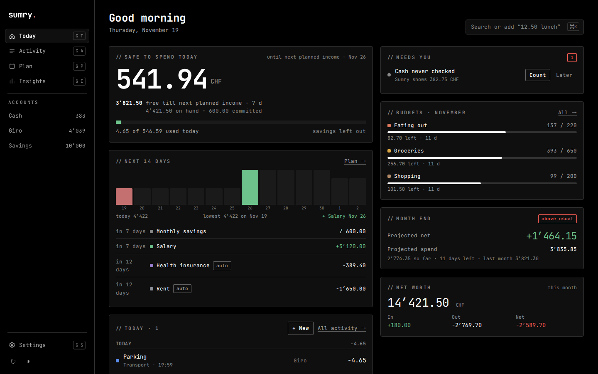
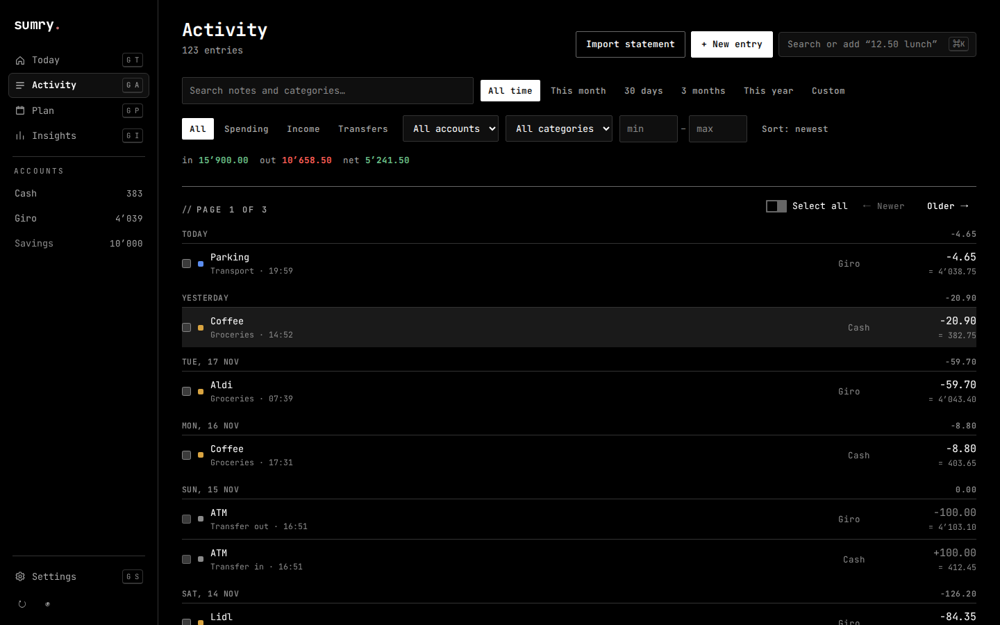
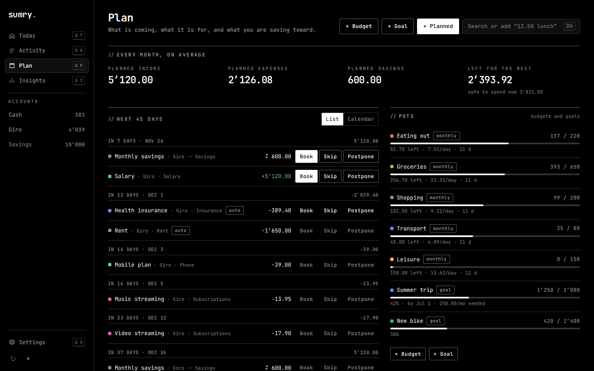
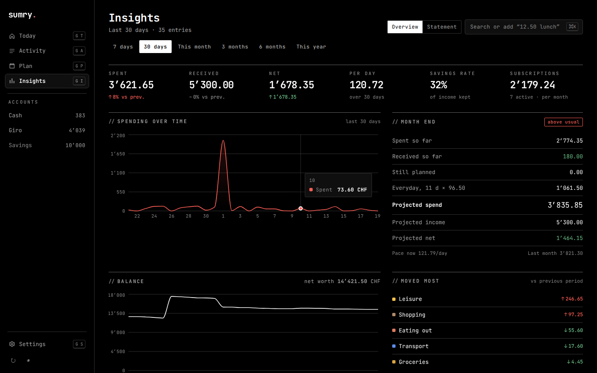
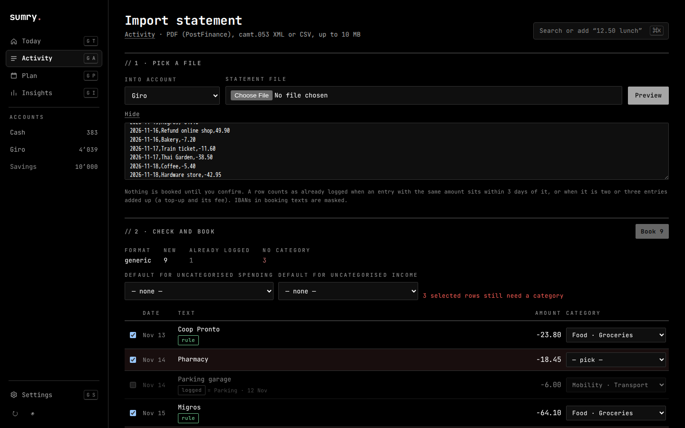
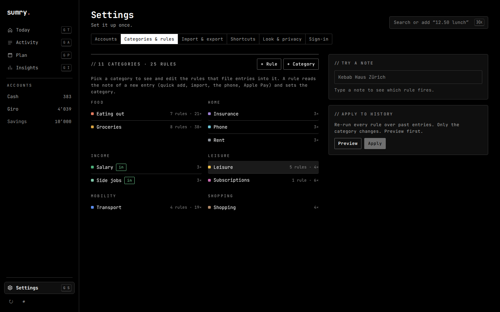
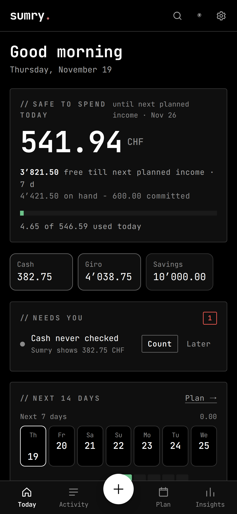

<a id="readme-top"></a>

<div align="center">

<h1>sumry.</h1>

<p><b>A calm personal finance tracker you can host yourself.</b><br>This is the web app: React and Vite, installable on a phone as a PWA.<br>It runs on the <a href="https://github.com/elyesghazel/sumry-backend">sumry-backend</a> API; Android has <a href="https://github.com/elyesghazel/sumry-app">sumry-app</a>.</p>

<p>
  <a href="https://github.com/elyesghazel/sumry-frontend/actions/workflows/ci.yml"></a>
  <a href="LICENSE"></a>
  
  
  
</p>

<p><a href="#features"><b>Features</b></a> · <a href="#install-on-iphone-pwa"><b>iPhone</b></a> · <a href="#self-host"><b>Self-host</b></a> · <a href="#hosted"><b>Hosted</b></a> · <a href="#configuration"><b>Configuration</b></a> · <a href="#development"><b>Development</b></a></p>

</div>

---



Sumry shows how much you can spend today without touching what is already planned, where
the month is heading and what is due next. You log entries in a line of text
(`12.50 lunch cash`), import bank statements, and plan the rest. No bank login and no
third-party code: the page talks only to your own server.

## Features

- **Today.** Safe to spend until the next planned income, the next 14 days as a bar per day,
  budgets, the month-end forecast, net worth, and a "needs you" list (accounts to check
  against the bank, plans to book).
- **Activity.** Every entry, searched and filtered on the server (period, account, category,
  amount, spending or income) with totals for the whole match. Each row opens the editor,
  and selected rows can be moved to another category at once.
- **Plan.** Planned income, bills and transfers as a list or a calendar, with Book, Skip and
  Postpone. Budgets with a start day and rollover, and savings goals with what is needed per
  month.
- **Insights.** Spending over time, balance, the month-end forecast, what moved most against
  the previous period, detected subscriptions, and the monthly statement.
- **Import.** PostFinance PDF, camt.053 XML and CSV. You see every row before anything is
  booked: rule matches, entries already logged, rows that still need a category.
- **Quick add** with <kbd>⌘K</kbd> / <kbd>Ctrl K</kbd>: `12.50 kebab cash yesterday`,
  `got 300 salary`, `500 from giro to savings`, parsed as you type and booked on Enter. It
  also searches.
- **Settings.** Accounts and reconciling, categories and rules (with a test box and a dry run
  over history), import and CSV/JSON export, an Apple Pay shortcut, theme, density, blurred
  amounts, sessions, and deleting the account.
- **Keyboard.** <kbd>g</kbd> then <kbd>t</kbd> / <kbd>a</kbd> / <kbd>p</kbd> /
  <kbd>i</kbd> / <kbd>s</kbd> jumps between pages.
- Dark and light, JetBrains Mono throughout, self-hosted fonts.

| Activity | Plan |
| --- | --- |
|  |  |
| **Insights** | **Import** |
|  |  |
| **Settings** | |
|  | |

The screenshots show invented demo data from
[`deploy/demo-seed.sh`](https://github.com/elyesghazel/sumry-backend/blob/main/deploy/demo-seed.sh)
in the backend repo.

## Using it

1. Sign in. If the instance allows signups, the sign-in screen offers **Create an account**;
   with invites on it asks for a code. An invite link (`/?invite=CODE`) fills it in.
2. Add your accounts in **Settings > Accounts** with their current balance.
3. Log entries with quick add, or import a statement from **Activity > Import statement**.
   Add rules for what keeps coming back, so imports and quick add pick the category.
4. Put rent, salary, insurance and savings transfers in **Plan**. Safe to spend on Today
   counts them from then on.
5. Now and then, **Check** an account on Today against the real balance; the difference is
   booked as an adjustment.

## Install on iPhone (PWA)

<p align="center"></p>

1. Open your Sumry address in **Safari** (other browsers on iOS cannot install web apps).
2. Tap **Share**, then **Add to Home Screen**, then **Add**.
3. Open Sumry from the home screen and sign in. It runs full screen, without the browser bar,
   with its own tab bar at the bottom.

What works offline: the app itself is cached, so it opens instantly. Balances and entries
are never cached, because a stale balance is worse than none, so without a connection it
shows that the server cannot be reached, keeps you signed in, and reloads once the
connection is back. Entries cannot be logged offline.

Android: install the APK from the
[sumry-app releases](https://github.com/elyesghazel/sumry-app/releases), or add this web app
to the home screen from Chrome the same way.

## Self-host

The [sumry-backend self-host guide](https://github.com/elyesghazel/sumry-backend/tree/main/deploy)
runs everything in one compose stack: Postgres, Redis, the API, this web app (the prebuilt
`ghcr.io/elyesghazel/sumry-frontend` image) and Caddy with automatic HTTPS. Start there.

To serve this container behind your own proxy instead, route `/api` to the backend and
everything else here:

```bash
docker compose up -d --build    # serves on http://localhost:8080 (SUMRY_WEB_PORT)
```

`deploy/traefik.example.yml` shows the same with Traefik. If the API lives on another
origin, build with `VITE_API_URL` and list this origin in the backend's
`SUMRY_CORS_ALLOWED_ORIGINS`, otherwise the browser blocks every request.

## Hosted

Elyes Ghazel also runs a hosted Sumry. Free covers 2 accounts without statement import;
Premium (2 CHF a month or 18 CHF a year) and Founder Lifetime (29 CHF, first 50 users)
unlock everything. Payment is manual via TWINT for now. Self-hosted, every feature is free.
Details are in the [backend README](https://github.com/elyesghazel/sumry-backend#hosted).

## Configuration

| Variable | When | |
|---|---|---|
| `VITE_API_URL` | build time | Absolute API origin. Empty (default) means same-origin `/api`. Vite inlines it, so changing it means rebuilding |
| `SUMRY_WEB_PORT` | `docker compose` | Host port for the container (default `8080`) |
| `SUMRY_API_PROXY` | `npm run dev` | Where the dev server sends `/api` (default `http://localhost:48090`) |

Everything else (registration, plan limits, mail, the AI check) is configured on the
backend; see its [configuration table](https://github.com/elyesghazel/sumry-backend#configuration).
The web app reads what it needs from `/api/config` and `/api/users/me`, so features the
server has off simply do not show.

## Development

Needs Node 22 and a backend on `localhost:48090` (in sumry-backend: `docker compose up -d --build`).

```bash
npm install
npm run dev       # http://localhost:5173, /api proxied to the backend
npm test          # vitest, core/ logic
npm run lint      # oxlint
npm run build     # type check and production build into dist/
```

```
core/            pure logic shared with the phone app: API client, types, analytics,
                 plan and import helpers, formatting (tests in tests/core)
src/
  store.tsx      session, data, hash routing, preferences
  pages/         Today, Activity, Plan, Insights, Import, Settings, AccountDetail, Login
  components/    navigation and quick add, editors, entry list
  charts.tsx     chart wrappers on the design tokens
  styles.css     tokens and layout
public/          manifest, icons and the service worker (the API is never cached)
```

`scripts/sync-core.sh` copies `core/` into a sumry-app checkout so both clients share one
contract. Reports add up in the base currency: each entry carries its value in the base
currency at booking time. Pushes to `main` publish `ghcr.io/elyesghazel/sumry-frontend:latest`.

See [CONTRIBUTING.md](CONTRIBUTING.md) for checks, commits and the CLA. Security reports go
through the backend's [SECURITY.md](https://github.com/elyesghazel/sumry-backend/blob/main/SECURITY.md).

## License

[AGPL-3.0](LICENSE). You may self-host Sumry, change it and use it commercially. If you
modify it and offer it to others as a service over a network, you have to publish the source
of your modified version under the same license.

The name "Sumry" and the logo are not part of the license: forks and public hosts use their
own name. See [TRADEMARK.md](TRADEMARK.md). Contributions are accepted under the
[CLA in CONTRIBUTING.md](CONTRIBUTING.md#contributor-license-agreement).

<div align="right"><a href="#readme-top">back to top ↑</a></div>
